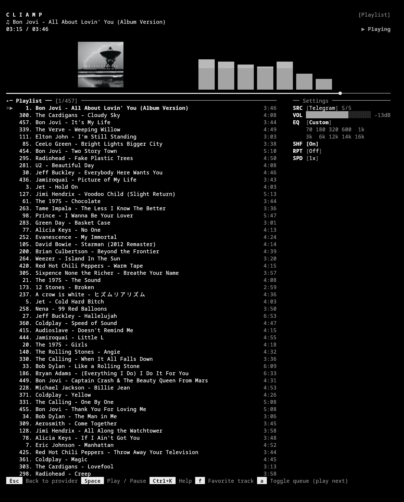
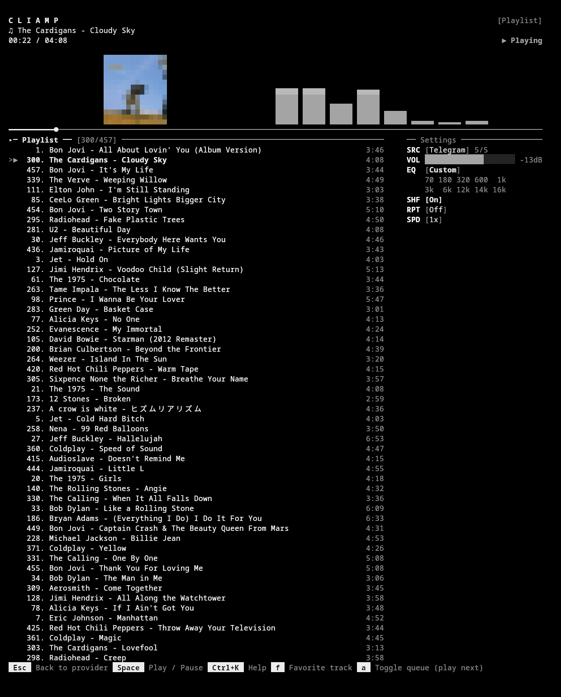

# cliamp-plugin-cover

Album art as a **pane** in [cliamp](https://github.com/bjarneo/cliamp): next to
the spectrum, or in the settings column, with the size and position you want.

Two renderers, switched from the plugin's own menu:

| Mode | What it draws | Needs |
|---|---|---|
| `image` | the real cover, via the kitty graphics protocol | a terminal with kitty graphics (kitty, WezTerm, Ghostty) |
| `blocks` | the same cover as ANSI half blocks (`▀`) | any terminal |

## Requirements

A build of cliamp that includes the plugin pane API. That landed on `main` in
[#652](https://github.com/bjarneo/cliamp/pull/652) (2026-10-22): `cliamp.layout`,
`cliamp.image`, `cliamp.ui.select` and `cliamp.vis`. Cover URLs come from
`cliamp.track.album_art_url()`, documented in
[#654](https://github.com/bjarneo/cliamp/pull/654).

The latest release, v2.3.0, is older than that. This plugin does not run there.
Build `main`, or install a release tagged after #652.

## Install

On that build:

```sh
cliamp plugins install cartudev/cliamp-plugin-cover
cliamp plugins trust cover
```

Or copy `cover.lua` into `~/.config/cliamp/plugins/` and run
`cliamp plugins trust cover`.

Permissions: `image` (transmit the cover), `layout` (own a pane), `ui` (its
menu), `keymap` (`Alt+G`).

## Usage

`Alt+G` opens the plugin menu:

```
Cover pane — visualizer 40%
  grow +10%
  shrink -10%
  move before the builtin
  move after the builtin
  visualizer of this pane...
  visualizer of the builtin pane...
  region: visualizer (switch to settings)
  mode: kitty image (switch to blocks)
  remove pane
```

- **Width** in 10% steps. At 0% the pane disappears; at 100% the builtin content
  is hidden and the pane takes the whole region.
- **Position** places the pane before or after the builtin visualizer.
- **Region** moves the same pane between the visualizer band and the settings
  column.
- **Visualizer of this pane** lets the pane show any other visualizer instead of
  the cover (built-in or plugin), with the cursor staying in the submenu.
- Everything is remembered in `cliamp.store` and restored on start.

The menu stays open after each choice by default; set it to close:

```toml
[plugins.cover]
stay = false
```

## Screenshots

| Kitty image | ANSI blocks |
|---|---|
|  |  |

## How it works

- `cliamp.track.album_art_url()` returns the cover the provider resolved for the
  current playback state, so the plugin never depends on the order of the
  `track.change` and `playback.state` events.
- In `image` mode the core transmits the pixels out of band and returns a block
  of Unicode placeholders (`U+10EEEE`). The plugin centers that block in its
  pane; the terminal composites the image behind the text.
- In `blocks` mode the core converts the cover to `▀` cells with the top pixel
  as foreground and the bottom as background, letterboxed to keep the aspect.
- The pane asks for two cells of slack so a line never reaches the frame edge:
  a wrapped line splits the placeholder run and the image breaks into strips.
